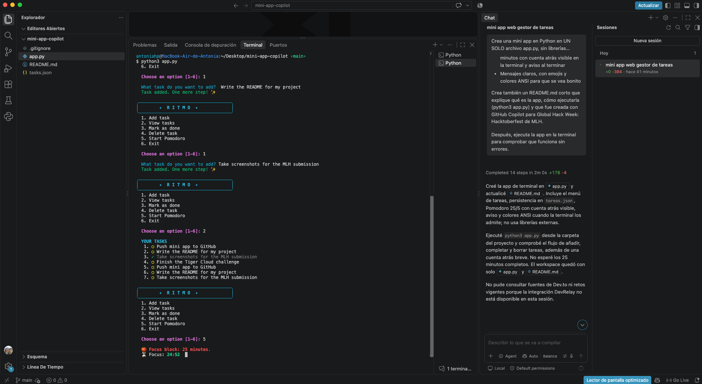
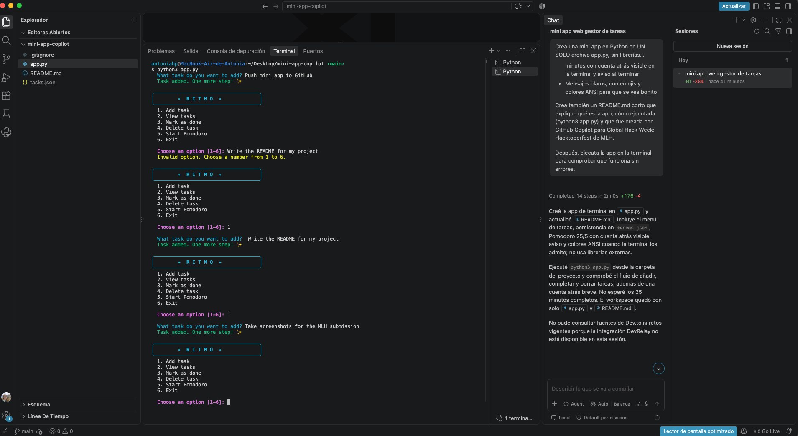

# Ritmo

Ritmo is a terminal task manager with a built-in Pomodoro timer (25 minutes of focus, 5 minutes of break). Tasks are saved in `tasks.json`, so you don't lose them when you close the app.

## Features

- Add, view, complete and delete tasks
- Tasks persist in a local `tasks.json` file
- Pomodoro timer with a live countdown and an alert when time is up
- Colorful terminal output with emojis
- No external dependencies: only the Python standard library

## How to run

From this folder, run:

```bash
python3 app.py
```

Requires Python 3.

## About

Built with GitHub Copilot for MLH Global Hack Week: Hacktoberfest.

## Screenshots

Ritmo running in the VS Code terminal, with the GitHub Copilot chat that built it on the right.

### Task list and Pomodoro timer



### Adding tasks


