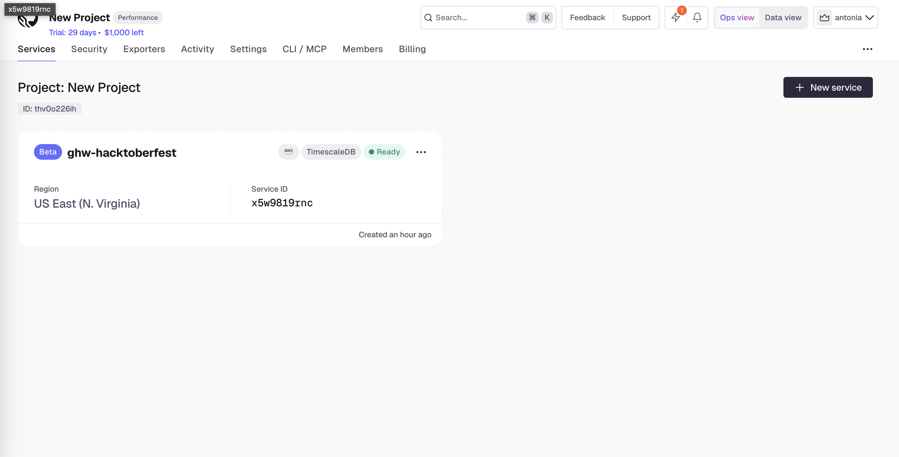
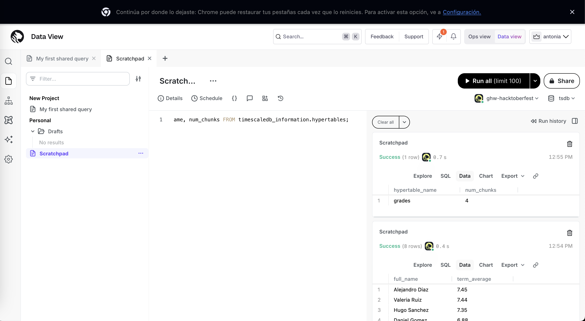
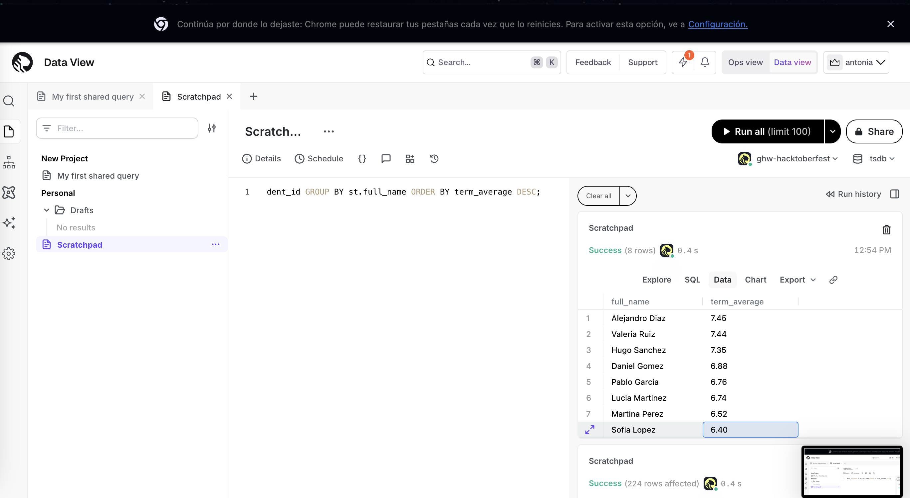

# Tiger Cloud: class grades hypertable + AI agent (MCP)

Challenges (MLH Global Hack Week: Hacktoberfest 2026):
- **Set up a Tiger Cloud service and create your first Hypertable**
- **Integrate Tiger Cloud with your AI Agent with the Tiger CLI and MCP**

## Goal

Connect a Tiger Cloud service (managed PostgreSQL) to GitHub Copilot in VS Code, so the AI agent can list and manage my database services through the Tiger MCP server.

## Steps

1. Create a free Tiger Cloud service in the Tiger Cloud Console.
2. Install the Tiger CLI:
   ```bash
   brew install --cask timescale/tap/tiger-cli
   ```
3. Log in and check the service:
   ```bash
   tiger auth login
   tiger service list
   ```
4. Install the Tiger MCP server for VS Code:
   ```bash
   tiger mcp install vscode
   ```
5. Restart VS Code and ask GitHub Copilot:
   - "Is the Tiger MCP server active?"
   - "Can you list my active services?"

## Result

I modeled the grades of a high school class during one term (September to December 2026):

- `students`: 8 students of class 4A
- `grades`: 224 exam scores (4 subjects, one exam every two weeks). It is a **hypertable** partitioned by `exam_date` in 1-month chunks, so it has 4 chunks.

The SQL is in [`schema.sql`](schema.sql) and the reusable queries are in [`queries.sql`](queries.sql). I ran them in the Tiger Cloud Data View (SQL editor).

### Tiger Cloud dashboard



### `grades` is a hypertable with 4 monthly chunks



### Term average per student


