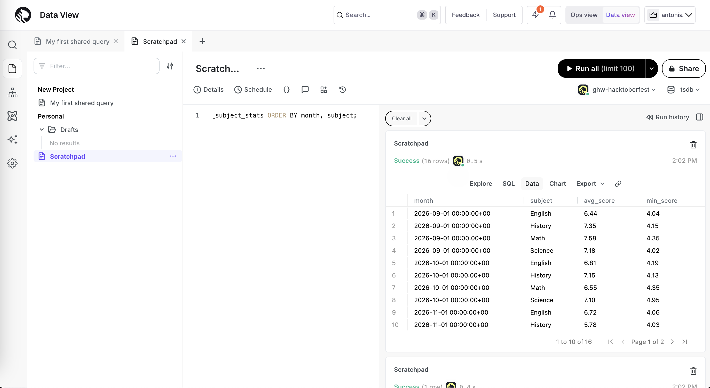
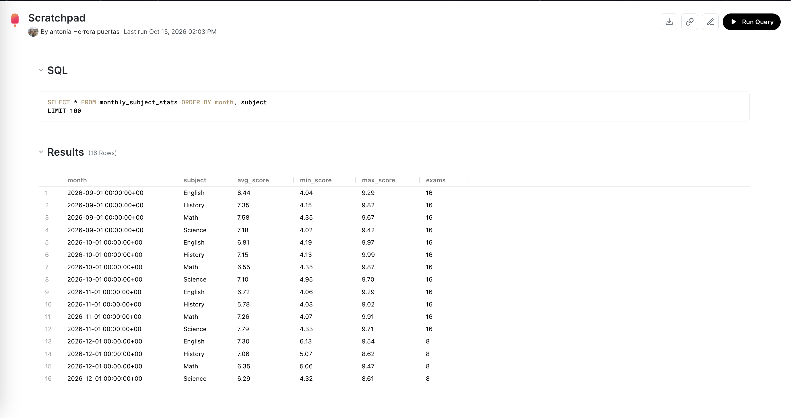

# Continuous aggregates on the grades hypertable

Challenge: **Accelerate Dashboards with Continuous Aggregates**, part of MLH Global Hack Week: Hacktoberfest 2026.

On top of the `grades` hypertable from [`../tiger-cloud-mcp`](../tiger-cloud-mcp), I created a continuous aggregate called `monthly_subject_stats`. It pre-computes, for every month and subject:

- average score
- minimum and maximum score
- number of exams

A refresh policy updates it automatically every hour, so a dashboard can read these stats instantly instead of scanning all the grades each time.

The SQL is in [`cagg.sql`](cagg.sql).

## Result

### Query in the Tiger Cloud Data View

### Full results (16 rows)

