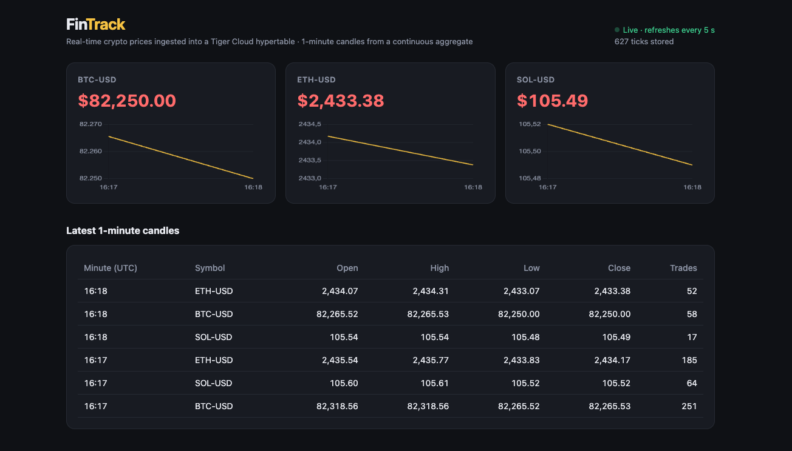
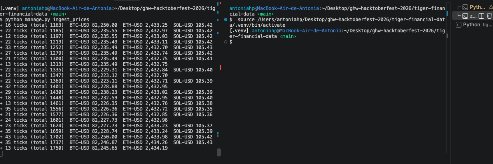

# FinTrack: real-time financial data in Tiger Cloud (Django)

Challenge: **Ingest real-time financial data into Tiger Cloud**, part of MLH Global Hack Week: Hacktoberfest 2026.

FinTrack is a small Django app that builds a real-time data pipeline:

```
Coinbase WebSocket (live BTC, ETH, SOL trades)
        │  python manage.py ingest_prices
        ▼
Tiger Cloud ── "ticks" hypertable (1 row per trade, partitioned by time)
        │       └─ "ticks_1m" continuous aggregate (1-minute OHLC candles, refreshed every minute)
        ▼
Django dashboard (http://127.0.0.1:8000) ── live prices, charts and candles, refreshed every 5 s
```

- **Ingestion**: a Django management command subscribes to Coinbase's public `ticker` channel (no account or API key needed) and inserts trades in batches every 2 seconds.
- **Storage**: `ticks` is a TimescaleDB hypertable. `ticks_1m` is a real-time continuous aggregate with open, high, low, close, volume and number of trades per minute.
- **Dashboard**: a Django view reads the latest prices and the 1-minute candles, and the page refreshes itself through a small JSON API (`/api/prices/`).

### Live dashboard (real Coinbase data stored in my Tiger Cloud service)



### Ingestion running: trades inserted in batches every 2 seconds



## How to run it

You need Python 3.10+ and a Tiger Cloud service.

1. **Create a virtual environment and install the dependencies**
   ```bash
   cd tiger-financial-data
   python3 -m venv .venv
   source .venv/bin/activate
   pip install -r requirements.txt
   ```
2. **Add your Tiger Cloud connection string.** Copy `.env.example` to `.env` and paste your connection string (Tiger Cloud Console → your service → *Connect*). `.env` is git-ignored, so your password never gets committed.
   ```bash
   cp .env.example .env
   ```
3. **Create the hypertable and the continuous aggregate**
   ```bash
   python manage.py migrate
   ```
4. **Start ingesting live prices** (keep this terminal open)
   ```bash
   python manage.py ingest_prices
   ```
   Options: `--symbols BTC-USD ETH-USD`, `--seconds 300` to stop after 5 minutes, or `--demo` to simulate prices offline.
5. **Open the dashboard** in a second terminal
   ```bash
   source .venv/bin/activate
   python manage.py runserver
   ```
   Then go to http://127.0.0.1:8000.

## Useful queries (Tiger Cloud SQL editor)

```sql
-- Ticks stored per symbol
SELECT symbol, count(*), min(time), max(time) FROM ticks GROUP BY symbol;

-- Latest 1-minute candles
SELECT * FROM ticks_1m ORDER BY bucket DESC, symbol LIMIT 15;
```

## Tests

```bash
python manage.py test market
```
