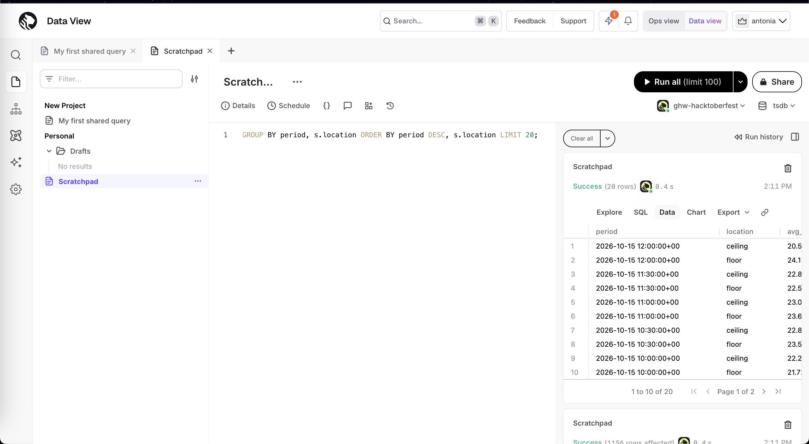
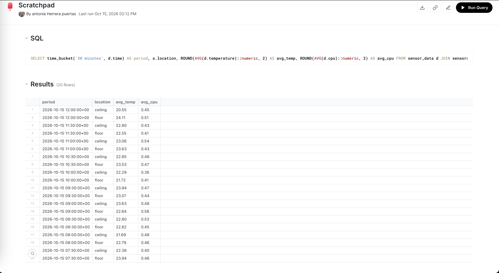

# Simulated IoT sensor dataset

Challenge: **Simulate an IoT sensor dataset for testing and development with Tiger Cloud**, part of MLH Global Hack Week: Hacktoberfest 2026.

In my Tiger Cloud service (`ghw-hacktoberfest`) I simulated 4 sensors (2 on the floor, 2 on the ceiling) reporting temperature and CPU usage every 5 minutes for the last 24 hours:

- `sensors`: the 4 sensors and their location
- `sensor_data`: 1,156 readings, stored in a **hypertable** partitioned by time

Then I queried the data with `time_bucket` to get the average temperature and CPU every 30 minutes for each location.

The SQL is in [`sensors.sql`](sensors.sql).

## Result

### Query in the Tiger Cloud Data View

### Average temperature and CPU every 30 minutes

