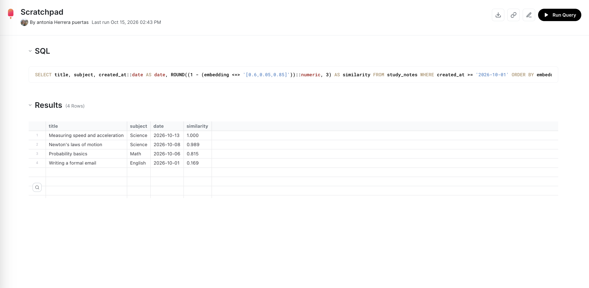

# AI-powered vector search with pgvector

Challenge: **Implement AI-Powered Vector Search with pgvector**, part of MLH Global Hack Week: Hacktoberfest 2026.

In my Tiger Cloud service (`ghw-hacktoberfest`) I stored class study notes with a vector embedding next to their date, in a **hypertable**:

- `study_notes`: 9 notes (Math, English, Science, History) from September and October 2026
- `embedding vector(3)`: a simple 3-dimension embedding that represents how much each note is about **[math, languages, science]**

Then I ran a **similarity search** inside PostgreSQL with pgvector's cosine distance operator (`<=>`): "find the notes closest to a physics-with-math question, only from October". It combines a time filter with vector distance.

The SQL is in [`vector-search.sql`](vector-search.sql).

## Result

The two physics notes come first (similarity 1.000 and 0.989), followed by the math note, while the English note is the least similar:

### Query in the Tiger Cloud Data View

### Results

